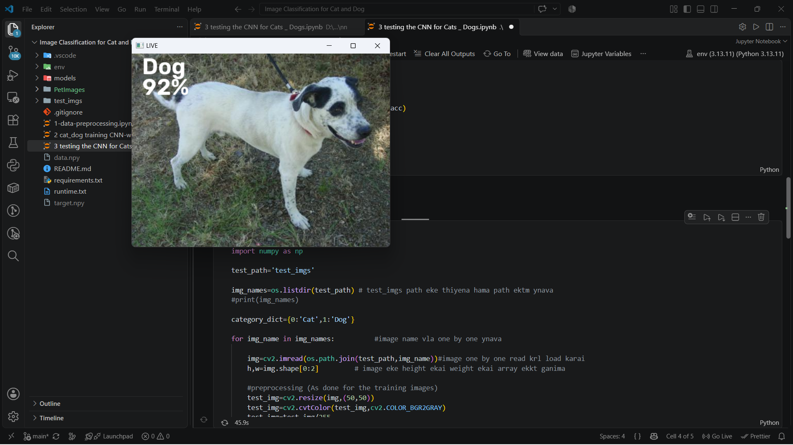
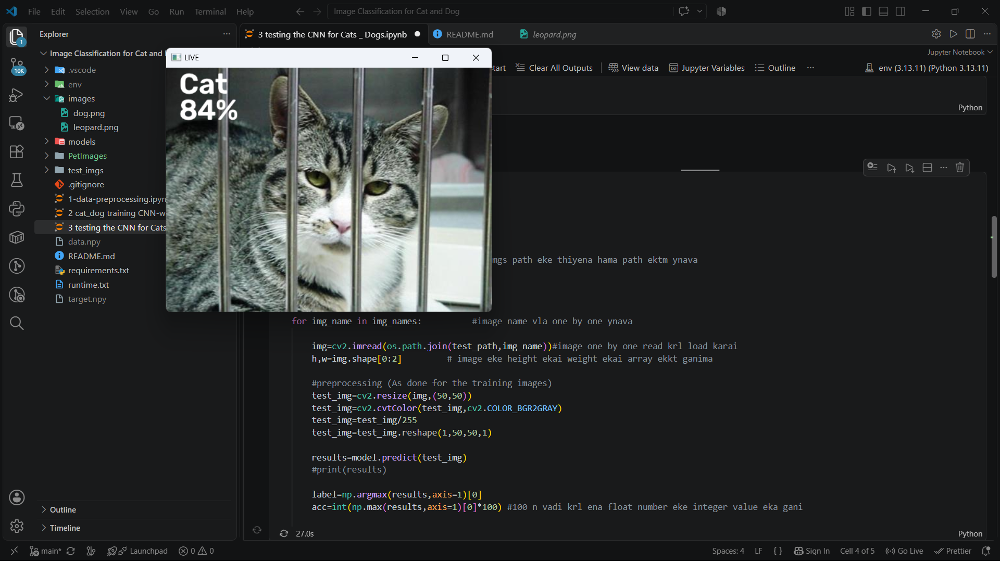
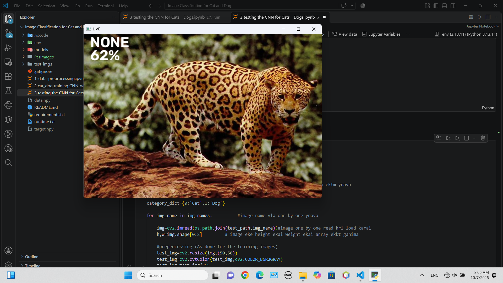

# 🐱🐶 Image Classification for Cat and Dog using CNN

🔗 **Repository Link:** [https://github.com/LahiruButhsara34/Image-Classification-for-Cat-and-Dog](https://github.com/LahiruButhsara34/Image-Classification-for-Cat-and-Dog)

This project builds a custom **Convolutional Neural Network (CNN)** model using Keras and TensorFlow to classify images of cats and dogs. It includes complete data preprocessing, CNN training with data augmentation and regularization techniques, model evaluation, and inference on test images as well as live camera feed with confidence thresholding.

---

## 📸 Output & Prediction Screenshots

### 1. Dog Detection Output (High Confidence)
Prediction displaying the predicted class (`Dog`) alongside accuracy percentage overlaid on the test image.

### 2. Low Confidence / Unknown Class Thresholding (`NONE`)
If the model's confidence accuracy drops below the threshold (< 70–75%), it dynamically flags the object class as `'NONE'` to avoid false positives.

---

## 📌 Key Features

- **End-to-End Pipeline:** Complete workflow covering raw image preprocessing, CNN training, checkpoint saving, and live inference.
- **Deep CNN Classifier:** Multi-layer convolutional architecture integrated with Batch Normalization, Orthogonal Initialization, and Dropout layers to minimize overfitting.
- **Real-Time Camera & Image Testing:** Real-time visual interface using OpenCV to process static images or live video frames.
- **Confidence Thresholding:** Automatically assigns label as `'NONE'` when detection confidence is below 70-75% threshold.

---

## 🛠️ Tech Stack & Requirements

### Tech Stack
- **Programming Language:** Python 3.13
- **Deep Learning Framework:** TensorFlow / Keras
- **Computer Vision & Processing:** OpenCV (`cv2`), NumPy, Pandas
- **Visualization:** Matplotlib
- **Environment:** Jupyter Notebook / VS Code

### Requirements
- **Python Version:** python-3.13.11
- **Dependencies:** `pip install -r requirements.txt`

---

## 🧠 Model Architecture & Hyperparameters

The neural network utilizes a **3-Block Convolutional Funnel Architecture** followed by fully connected dense layers:

- **Input Shape:** $50 \times 50 \times 1$ (Grayscale)
- **Optimizer & Loss:** Adam (`learning_rate=0.0001`), Categorical Crossentropy
- **Layer Pipeline:**
  1. `Conv2D (32 filters, 3x3)` + `BatchNormalization` + `ReLU` + `MaxPooling2D (2x2)`
  2. `Conv2D (64 filters, 3x3)` + `BatchNormalization` + `ReLU` + `MaxPooling2D (2x2)`
  3. `Conv2D (128 filters, 3x3)` + `BatchNormalization` + `ReLU` + `MaxPooling2D (2x2)`
  4. `Flatten`
  5. `Dense (128 units, activation='relu')` + `Dropout(0.5)`
  6. `Dense (64 units, activation='relu')` + `Dropout(0.3)`
  7. `Dense (2 units, activation='softmax')`
  

---

